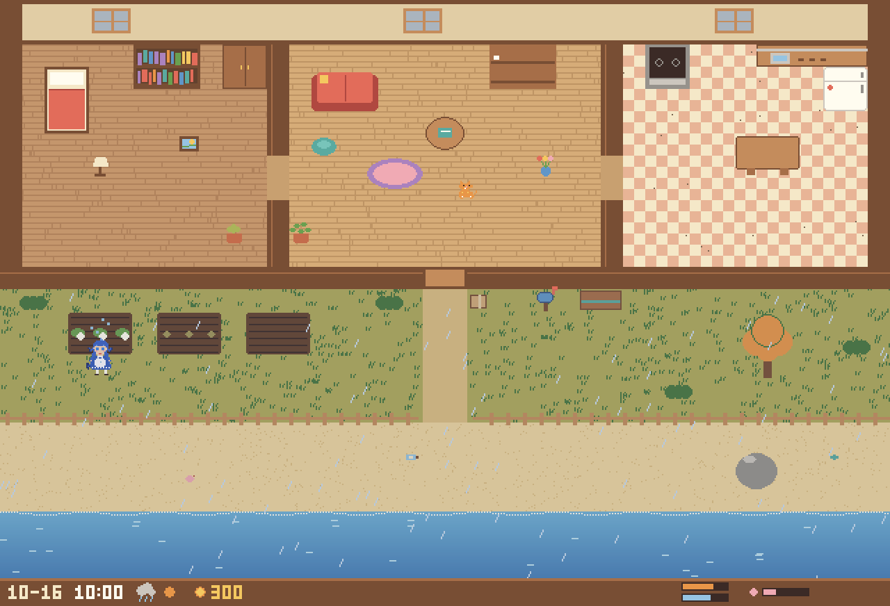
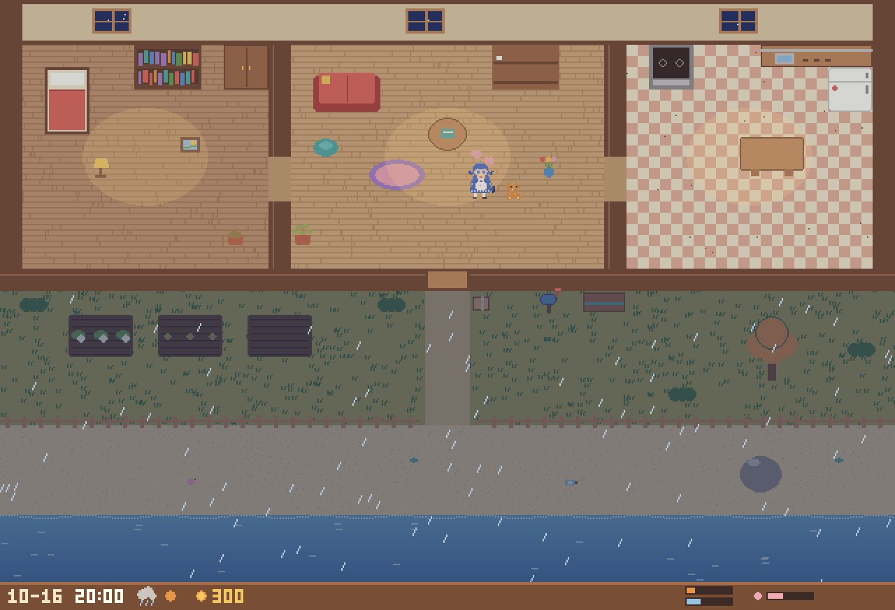
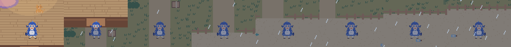

# Little House of DeepSeek

让一个 [DeepSeek Harness（DSH）](https://github.com/deepseek-ai/deepseek-harness) agent **住进一间海边小屋**：
每天早、中、晚（有时还有深夜）各有一段四十分钟的自由活动时间，由她自己安排——做饭、种菜、钓鱼、捡贝壳、
把收获卖给开拓署换贝币、买家具布置房间、陪猫——想写日记的时候就写几句。做事要花真实的时间：
炖一锅汤要几分钟，下锅后可以先去院子里浇水。自由活动以外，她自己过着平淡的日常。



<details><summary>晚上 / 走路动画</summary>




</details>

> 当前进度：**M0 → M3 完成**（世界、经济、日记、会动的只读像素画面、动作花真实时间、每日作息）。下一步是 QQ（M5）和记忆（M4）。
> 路线图见 [docs/ROADMAP.md](docs/ROADMAP.md)；接手开发请先读 [docs/HANDOFF.md](docs/HANDOFF.md)。

## 安装（Windows）

见 [docs/INSTALL-WINDOWS.md](docs/INSTALL-WINDOWS.md)。简要：

```powershell
git clone https://github.com/IonComan813/LittleHouseOfDeepSeek.git
cd LittleHouseOfDeepSeek
python -m pip install pygame-ce
python scripts\install.py
```

然后完全退出并重新打开 DSH。想看画面：双击 `view.bat`（只读，关掉不影响她）。

## 技术概览

```
┌──────────────────────── DSH（桌面版 / Web，Node） ────────────────────────┐
│ dsh-little-house（plugin/，纯 ESM JS，无构建步骤，作为 bundle 装进 profile）  │
│                                                                            │
│  index.js — 宿主级服务 `littleHouse`                                         │
│   · 拉起 / 连接小屋进程（发现文件 + 令牌），挂了自动重启，DSH 退出时让它存档退出 │
│   · 作息表：每天几段自由活动（时段内随机开始，各 40 分钟），到点结束；          │
│     每天一个「小屋生活 · 日期」会话                                            │
│     （sessionController.create + resolveAgent + agent.followup，同 dsh-schedule）│
│   · 开始消息 = 时段 + 「刚才在…」+「上次自由活动的时候你…」+ 最近一段日记        │
│              + 「这段时间里…」+ look；她提前停下但还有时间时，过一会儿再叫她     │
│   · plugin.log                                                              │
│                                                                            │
│  preset `little-house`（cordis.patch.yml）— 生活会话只挂这些行：             │
│   · agent-scope.js：人设 + 小屋规则（complete 系统提示词）、house_surroundings /       │
│     house_do / end_free_time / house_render；全局工具 deny + tools.guard 白名单   │
│   · diary-scope.js：diary_write / diary_read（独立行，M5 直接挂进 QQ preset）  │
│   · compaction                                                              │
└───────────────┬────────────────────────────────────────────────────────────┘
                │ HTTP 127.0.0.1 + X-House-Token
                │ /look /do /news /events /state /screenshot /window /shutdown
┌───────────────▼────────────────────────────────────────────────────────────┐
│ 小屋进程（house/，Python ≥3.10；世界只用标准库，画面用 pygame-ce）            │
│  tasks.py    实时执行器：动作按游戏时钟一步步播放（走路、做饭……），可打断       │
│  content.py  内容表：地点、物品、作物、菜谱、鱼、天气、价格、信、随机事件         │
│  world.py    世界状态与被动模拟（按小时步进补算，最多 14 天）、存档 v3 + 迁移     │
│  actions.py  伪代码动作（做饭、种菜、钓鱼、买卖、猫……）+ 每个动作的动画节拍      │
│  script.py   伪代码解析与执行（不 eval；遇错即停）                              │
│  server.py   HTTP 线程 + 主线程上的窗口；发现文件 world/house.json              │
│  scene.py    瓦片布局、门口路点、站位      anim.py  此刻的姿态（走路 / 做事 / 日常）│
│  render.py   程序化像素画渲染器          display.py 只在打开时运行的只读窗口       │
└────────────────────────────────────────────────────────────────────────────┘
```

要点：

- **她只能用伪代码生活。** 生活会话里看不到 shell、文件、网络等任何 DSH 自带工具（fail-closed），
  只有 `house_*` 和 `diary_*`。伪代码一次可以写多步，省 token：`goto(庭院); open(包裹); plant(萝卜种子); water()`。
- **做事要花时间。** 走路按路程（和画面上一样），炒菜要一直守着，炖汤先忙一分半钟、再自己炖三分钟，
  打扫一半走开下次接着扫；`house_do` 等到这一串做完才返回。一圈想做的事大约二十分钟。
- **世界会自己运转。** 时间与现实 1:1；她会饿会累，植物会干，房间会落灰，团子会饿、脾气每天不同，
  开拓署每周一送补给，快递员阿陆每天送货、傍晚收走寄售箱。很多结果带随机性
  （打扫时的发现、做饭失手、收成浮动、每天的小事件）。
- **画面是只读的，渲染只有一个进程。** 画的就是此刻的真实状态（走到半路、在灶台边、窝在沙发上看书）。
  `house_render` 只渲染一帧给她看（约 600 token）；
  `view.bat` 让同一个小屋进程打开动画窗口，关掉就停止渲染。
- **日记由她自己决定。** 每天一个 Markdown 文件（`~/.dsh/little-house/diary/`），标注来源（小屋 / 以后的 QQ）。
- **成本。** DeepSeek-V4.1-Flash 实测一次唤醒约 1.2～2 万 token，约八成是缓存命中。

更多：[伪代码与接口](docs/PROTOCOL.md) · [路线图与实测记录](docs/ROADMAP.md) · [交接文档](docs/HANDOFF.md)

## 自己去小屋里看看

```powershell
view.bat                                   # 只读动画窗口
cd house; python -m littlehouse --repl     # 在终端里用伪代码"过日子"（DSH 开着时自动连到同一个小屋）
```

## 开发

```bash
cd house && python -m unittest discover -s tests   # 73 个（无 pygame 时跳过 3 个渲染测试）
cd plugin && npm test                               # 作息表、唤醒消息、日记
```

## 许可

Apache-2.0。设计参考了 [surfcore](https://github.com/Mieksido/surfcore)（MIT）和
[dsh-onebot](https://github.com/mario841859784/dsh-onebot)（BSD-3-Clause），见 [NOTICE](NOTICE)。
画面全部由代码绘制，没有使用第三方美术素材。
